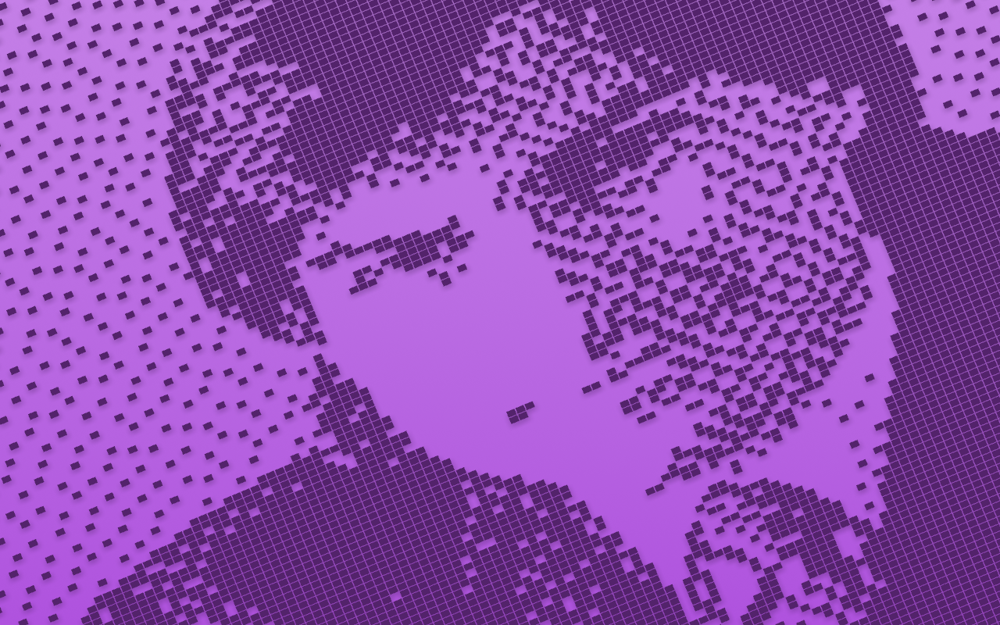

# Macintosh screensaver, reimplemented for the web

A WebGL2 reimplementation of the "Macintosh" screensaver / wallpaper that ships
with macOS 26 (`WallpaperMacintoshExtension.appex`, the Metal-based "Macintosh
40th Anniversary" scenes). It plays Apple's own scene scripts and resources, so
the choreography (camera moves, the mouse drawing "hello" in MacPaint, the 1984
on the calculator, the 15-puzzle, the Style menu...) is the original one. On top
of Apple's 15 scenes it adds 17 of its own, written in the same scene language.


*Apple's MacPaint "hello" scene, asked to write something else. The scene scripts are plain text, so an agent (or you) can change an existing program: this one is `MacPaintHello` with a new set of mouse strokes.*



*A program that does not exist in the original: the Scrapbook desk accessory, drawn and scripted from scratch. New programs are a `.program` script plus a 1-bit image, and optionally a small JavaScript module for interactive controls.*

This repository holds the player and the project's own scenes only. **Apple's
resources are not included**: you extract them from your own copy of macOS 26
(see [Apple's resources](#apples-resources)). `NOTES.md` documents everything
that was reverse-engineered and how.

## Requirements

- A Mac with **macOS 26** (or a copy of its `WallpaperMacintoshExtension.appex`),
  once, to extract Apple's resources. The extraction needs bash and `plutil`
  only.
- Any static file server (ES modules need http, not `file://`), e.g. `python3 -m http.server`.
- A browser with **WebGL2**.

## Setup

```
git clone https://github.com/SabatinoMasala/macintosh-screensaver-web.git
cd macintosh-screensaver-web
scripts/extract-apple-assets.sh     # copies Apple's resources into assets/apple/
python3 -m http.server 8765
open http://localhost:8765/
```

`scripts/extract-apple-assets.sh --check` verifies an existing extraction
without touching anything.

Without Apple's resources the page still loads: it shows a notice and plays the
six project scenes that need none of them (Scrapbook, Mines, Solitaire, the
Solitaire win, Photoshop, HyperCard), without a mouse pointer. Every other
scene is skipped, as is any scene whose files are missing from a partial
extraction. The browser console says which scenes were skipped and why.

## Use

Controls: tap the screen or move the mouse to show the control bar (bottom
right: settings, next scene, pause/resume, random colour, fullscreen); it fades
out after 3 s and stays up while the settings panel is open. Tap outside the
panel to close it. The fullscreen button is hidden where the browser has no
fullscreen API (iPhone Safari: use "Add to Home Screen" instead, which runs it
without browser chrome).

Keys: `S` settings panel, `N` next scene, `Space` pause, `R` new random colour,
`F` fullscreen, `Esc` close the panel.

Query parameters: `?program=MacPaintHello&color=blue&appearance=dark&contrast=0.2&speed=2`.
Look settings for tuning on your own screen (panel or URL): `shadow`,
`shadowSize`, `shadowSoftness`, `pixelRatio` (`auto` / 1 / 2 / 3).

## Apple's resources

The player needs files that belong to Apple. They ship with macOS 26 in
`/System/Library/ExtensionKit/Extensions/WallpaperMacintoshExtension.appex/Contents/Resources`,
and `scripts/extract-apple-assets.sh` copies them, by exact file name, into
`assets/apple/`:

| Directory | What | Count |
|---|---|---|
| `assets/apple/programs/` | Apple's scene scripts (`*.program`): StartupHappyMac, StartupWelcome, Finder, IconGarden, IconGardenWallpaper, MacPaint, MacPaintHello, MacWrite, MacWriteTextInput, MacWriteStyleMenu, System1ControlPanel, System6ControlPanel, DeskAccessories, AlertSounds, QuitDialog | 15 |
| `assets/apple/images/` | the 1-bit screen images and sprite strips (`*.png`) | 32 |
| `assets/apple/fonts/` | the NFNT bitmap fonts Chicago 12, Geneva 12, Geneva 9, Monaco 9 (`*.bin`) | 4 |
| `assets/apple/cursors/` | the `CURS` cursors and `acur` animated cursors (`*.bin`) | 38 |
| `assets/apple/original/` | the untouched extension binary and its whole `Resources` folder (including `default.metallib`), for reference | |
| `assets/apple/shaders/` | the LLVM disassembly of the five Metal shaders, only generated when `python3` and `llvm-dis` (LLVM 20, `brew install llvm`) are installed; optional | 5 |

**`assets/apple/` is gitignored. Never commit these files and never
redistribute them**, in this repository, a fork, a release or a deployed
copy of the site: they are Apple's.

The extraction copies by allow-list, so another macOS 26 build with extra files
still gives the same layout. It warns about every missing file and exits
non-zero when any is missing. Running it again is harmless: it overwrites the
same files. It prints the bundle version it found.

To extract from a copy of the extension instead of the running system (another
Mac, a mounted system volume, a backup), pass its path, or set
`MACINTOSH_APPEX`:

```
scripts/extract-apple-assets.sh /path/to/WallpaperMacintoshExtension.appex
MACINTOSH_APPEX="/Volumes/Macintosh HD/System/Library/ExtensionKit/Extensions/WallpaperMacintoshExtension.appex" \
    scripts/extract-apple-assets.sh
```

The positional argument wins over the variable, and the variable wins over the
default system path.

## Layout

```
assets/programs/  the project's own scene scripts
assets/images/    the project's own 1-bit images
assets/apple/     Apple's resources, extracted locally (gitignored, see above)
scripts/          extract-apple-assets.sh
src/dsl.js        parser for the *.program scene language (Apple's own regexes)
src/processor.js  the interpreter: timeline, async interpolations, gosub, waits
src/scene.js      the 512x342 1-bit screen: base image + controls + cursor
src/controls.js   button, radio, slider, text, clock, caret, puzzle, menu, icons, canvas...
src/scenes/       the game and application scenes, one module each
src/resources.js  the loader: project files from assets/, Apple's from assets/apple/
src/renderer.js   WebGL2: gradient background, instanced shadow + pixel tiles
src/colors.js     the colour pipeline (system colours, spectrum, light/dark, contrast)
src/nfnt.js       classic Macintosh bitmap font decoder
src/curs.js       classic cursor decoder (+ animated cursors)
tools/            the python helpers used for the analysis, the screenshot script (needs `npm install playwright`), the perf harness
screenshots/      renders of the project's scenes
```

`src/resources.js` keeps the lists of Apple's file names (`APPLE_PROGRAMS`,
`APPLE_IMAGES`; all fonts and cursors are Apple's), and loads each asset from
the tree it belongs to. Before a scene plays it checks that its script, every
image it shows and every font it draws with loaded; if one did not, the scene is
left out of the playlist and the menu.

## Scenes added by this project

Not part of Apple's set, built in the same language and style (scripts in
`assets/programs/`, 1-bit art in `assets/images/`, screenshots in `screenshots/`):

- `Scrapbook`: the Scrapbook desk accessory with an Atkinson-dithered portrait of
  Steve Jobs and the Macintosh (Bernard Gotfryd, January 1984, public domain via
  Wikimedia Commons / Library of Congress), page flip to the Mac itself.
- `NotePad`: the Note Pad types the Mac's first words from the 1984 introduction.
- `SystemError`: the bomb alert, Restart is pressed, the Mac reboots to the "?" floppy.
- `AlarmClock`: the Alarm Clock DA with the live time, opened with its lever.
- `AppleMenu`: the Apple menu pulled down over the Finder, released on Scrapbook.
- `MacPaintSabatino`: the MacPaint hello scene writing "Sabatino".

Games and applications, each a self-contained module in `src/scenes/<Name>.js`
that declares its program, images, fonts and its own control kind (the module
contract is documented in `src/scenes/index.js`):

- `Mines`: minesweeper with flood reveal, a flag, and a fatal click.
- `Hangman`: MACINTOSH won, then SABATINO lost on purpose.
- `Tetris` (1988 Mac look): patterned blocks, a four-line clear, levels.
- `Brickles` (1985 Breakout): deterministic physics, autopilot paddle, planned misses.
- `Daleks` (1984): numpad moves, sonic screwdriver, teleport, scrap heaps, game over.
- `Solitaire` (Klondike): fixed deal, legal drags to foundations, card flips.
- `Chess` (Sargon III): the Ruy Lopez by mouse drag and keyboard replies, move list.
- `Excel` 1.0: typing into cells, `=SUM(B2:B5)` = 1984, a range selection.
- `Photoshop` 1.0: marching-ants marquee on NASA's Earthrise, then a blur applied.
- `HyperCard` Home stack: a button press dissolves to the Address card, a wipe back.

Some of them draw on Apple's resources at run time (AppleMenu, SystemError and
MacPaintSabatino use Apple screen images; NotePad, AlarmClock and most games
draw text in Apple's fonts) and are skipped until those are extracted.

## What is faithful and what is approximated

Faithful (taken from the binary or the resources): the script language and
every script, the images, fonts and cursors, the orthographic camera model
(140-pixel window, roll + tilt from the script's `camera` command, fit scale,
`zoom` = 1 + 2·v), the colour pipeline (system colours, 0.3 dark factor,
26 % / 9 % gradient lightening, 0.2 / 0.666 contrast), the tile geometry (0.9
tiles, 2.25 shadows), the shadow (tile-coloured, 0.375 peak, separable
smoothstep falloff, from the disassembled `shadowFragment`) blended in linear
light like the Metal layer, the tile vertex shader (a port of the disassembled
`pixelVertex`: tile placement, the `scale` reveal, the `ramp` wipe), timings of
the menu flash, icon frames and the slider snapping, the control anchors.

Approximated: the caret blink rates and the puzzle's starting layout. We also
render with 4× MSAA where Apple uses none (rotated tiles alias badly at 1× on
non-Retina screens).

## Licensing

- **The project's code and its own scenes** (everything in this repository:
  `src/`, `scripts/`, `tools/`, the scene scripts and images in
  `assets/programs/` and `assets/images/`, `screenshots/`, the documentation)
  are released under the MIT License, see [`LICENSE`](LICENSE).
- **Apple's resources belong to Apple** and are not part of this project: the
  scene scripts, images, fonts, cursors, shaders and the extension binary that
  `scripts/extract-apple-assets.sh` copies from macOS. They are not licensed to
  you by this repository. Extract them from your own copy of macOS for your own
  use, and do not commit, publish or redistribute them.
- **A caveat about the project's own images:** the scene images this project
  drew (`assets/images/`) recreate the classic Macintosh look by reusing pixels
  from Apple's artwork (window chrome, the menu bar, desktop and Finder icons)
  and contain text set in Apple's bitmap fonts (Chicago, Geneva, Monaco). The
  screenshots in `screenshots/` are renders of the project's own scenes (some
  of which show Apple's screen images at run time). The MIT License covers the
  project's own contribution only. If you redistribute these images or
  screenshots, judge for yourself whether that is acceptable for your use.
- The Scrapbook portrait is a public-domain photograph (Bernard Gotfryd, 1984,
  Library of Congress), the Photoshop scene uses NASA's public-domain Earthrise.

This project is not affiliated with or endorsed by Apple. Macintosh, macOS,
MacPaint, MacWrite and HyperCard are trademarks of Apple Inc.; Excel is a
trademark of Microsoft, Photoshop of Adobe, Tetris of The Tetris Company.
